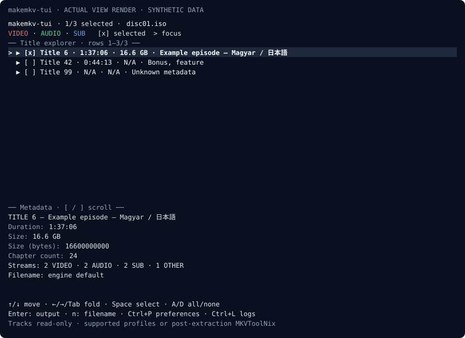
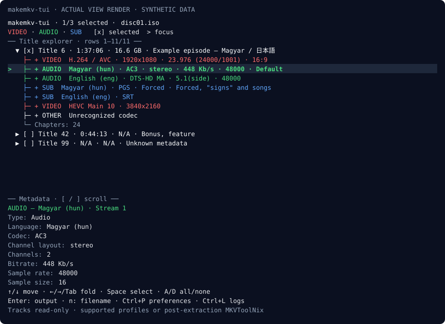
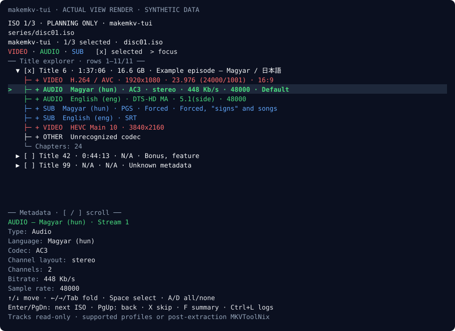
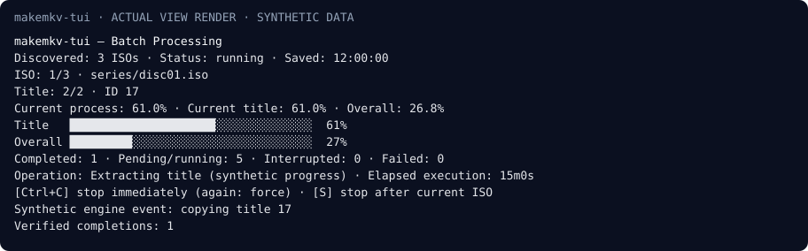
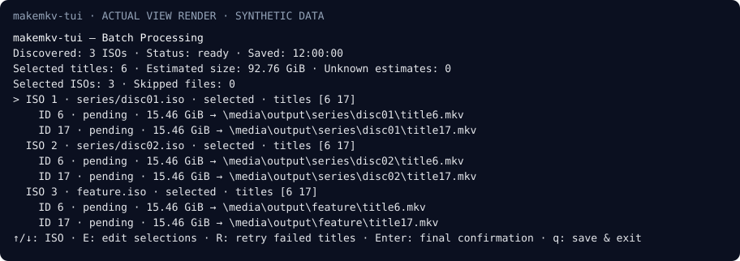

# makemkv-tui

A cross-platform terminal user interface for MakeMKV.

Browse titles and video, audio and subtitle metadata with a keyboard. Plan an ISO
collection before extraction, stop safely, and resume without repeating completed
work. Designed for FreeBSD and SSH, with Linux, macOS and Windows build support.

This independent frontend runs the separately installed **`makemkvcon` engine**.
MakeMKV is not included. Full MakeMKV GUI parity remains a product goal.

## Features

- Resizable, keyboard-driven, expandable title and stream hierarchy.
- VIDEO in red, AUDIO in green, SUB in blue; labels and `NO_COLOR` fallback.
- All reported tracks, codecs, languages, durations, sizes, flags and chapter counts.
- ISO files, DVD/Blu-ray folders including BDMV, and engine-accessible optical drives.
- Multiple title selection, output folders and single-source output filenames.
- Recursive ISO discovery with deterministic ordering, spaces and Unicode paths.
- Saved planning before extraction, final confirmation and preserved directory structure.
- Persistent JSON, title-level resume, verified outputs, failure retries and logs.
- Immediate stop or stop after the current ISO, live progress and expandable errors.
- Persistent preferences; optional external MKVToolNix review/remux after single-source extraction.

| Platform | Verification |
| --- | --- |
| FreeBSD amd64 | Primary target; cross-build verified. Real engine, FUSE, optical drives and SSH runtime tests still required. |
| Linux amd64 | Cross-build verified; native mocked tests configured in CI. |
| macOS amd64 / arm64 | Cross-build verified; native mocked tests configured in CI. |
| Windows amd64 | Native mocked tests and build verified; real engine extraction unverified. |

Cross-compilation does not establish runtime compatibility.

## Screenshots

Actual application **View renderer captures with synthetic fixture data**; these
are not live engine or native FreeBSD terminal captures. [Regeneration instructions](docs/screenshots/README.md).







## Requirements

Go **1.25.0 or newer** for building; no C compiler required. Install a working
`makemkvcon` separately and satisfy its engine license and usage requirements.
On Windows its executable is `makemkvcon.exe`. Optional MKVToolNix is separate too.
A UTF-8 terminal is required; ANSI colors are optional. Around 100×30 cells is
comfortable. No graphical desktop is needed.

Sources must be readable; output, state and preferences directories must be
writable. Allow up to **three copies of the current title** for safe-copy
publication on FreeBSD/Windows, in addition to previously completed outputs.

## Installation

The v0.2.0 workflow builds FreeBSD amd64, Linux amd64, Windows amd64, macOS amd64
and macOS arm64. **Run the download commands only after Actions has published the
v0.2.0 tag.** These expected asset names are a workflow contract, not a claim
that an unreleased asset already exists. [Releases](https://github.com/madarlevi/makemkv-tui/releases).

Each archive contains the frontend, README, MIT LICENSE, third-party notices and
BUILDINFO.json. Keep the notices when redistributing. MakeMKV is never bundled.

### FreeBSD

```sh
version=v0.2.0
archive=makemkv-tui-${version}-freebsd-amd64.tar.gz
base=https://github.com/madarlevi/makemkv-tui/releases/download/${version}
fetch "${base}/${archive}"
fetch "${base}/SHA256SUMS.txt"
expected=$(awk -v name="$archive" '$2 == name {print $1}' SHA256SUMS.txt)
[ -n "$expected" ] && [ "$expected" = "$(sha256 -q "$archive")" ] || exit 1
mkdir makemkv-tui-release
tar -xzf "$archive" -C makemkv-tui-release
./makemkv-tui-release/makemkv-tui --version
mkdir -p "$HOME/.local/bin"
install -m 755 makemkv-tui-release/makemkv-tui "$HOME/.local/bin/makemkv-tui"
```

Add $HOME/.local/bin to PATH if needed. Install the external engine separately;
the FreeBSD multimedia/makemkv port has its own license and Linux compatibility
requirements. The frontend is a native FreeBSD executable. Check makemkvcon --help
outside the TUI first. Preserve the included docs/license directory.

### Linux and macOS

Download the matching archive plus SHA256SUMS.txt from the actual release.
On Linux verify with `sha256sum --check --ignore-missing SHA256SUMS.txt`. On macOS,
compare `shasum -a 256 ARCHIVE` with its exact filename entry. Extract into a new
folder, run `./makemkv-tui --version`, then install it on PATH. macOS binaries
are not Developer ID signed/notarized; local OS security policy may require review.
Install MakeMKV separately using its [official instructions](https://www.makemkv.com/download/).

### Windows (PowerShell)

```powershell
$Version = 'v0.2.0'
$Archive = "makemkv-tui-$Version-windows-amd64.zip"
$Base = "https://github.com/madarlevi/makemkv-tui/releases/download/$Version"
Invoke-WebRequest "$Base/$Archive" -OutFile $Archive
Invoke-WebRequest "$Base/SHA256SUMS.txt" -OutFile SHA256SUMS.txt
$Pattern = '^[a-f0-9]{64}  ' + [regex]::Escape($Archive) + '$'
$Lines = @(Get-Content SHA256SUMS.txt | Where-Object { $_ -match $Pattern })
if ($Lines.Count -ne 1) { throw 'Missing or duplicate checksum entry' }
$Expected = $Lines[0].Split(' ')[0]
if ((Get-FileHash $Archive -Algorithm SHA256).Hash.ToLowerInvariant() -ne $Expected) { throw 'Checksum mismatch' }
Expand-Archive $Archive -DestinationPath makemkv-tui-release
.\makemkv-tui-release\makemkv-tui.exe --version
```

Add the frontend folder and the separately installed makemkvcon.exe folder to PATH.
Use a fresh extraction folder; unsigned Windows binaries may receive OS warnings.

### Source builds and go install

Go 1.25 is the minimum application API level. Use the compiler pinned in
[.go-version](.go-version), currently **1.26.10**, for release reproduction.

```sh
git clone https://github.com/madarlevi/makemkv-tui.git
cd makemkv-tui
git checkout v0.2.0  # after the tag exists
CGO_ENABLED=0 go build -mod=readonly -trimpath -buildvcs=false -ldflags "-X main.version=v0.2.0" -o makemkv-tui ./cmd/makemkv-tui
./makemkv-tui --version
```

PowerShell: set `$env:CGO_ENABLED='0'` and use `go build` with the same flags and
`-o makemkv-tui.exe`. For complete version/commit metadata use tools/release as
shown in [the release guide](docs/RELEASE.md).

```sh
go install github.com/madarlevi/makemkv-tui/cmd/makemkv-tui@latest
```

Add GOBIN or $(go env GOPATH)/bin to PATH. Module installations report their module
version; an untagged development build can say dev. Release executables must report
their exact tag. `makemkv-tui version --json` also shows the embedded identity.

### Package managers

FreeBSD Ports, WinGet, Scoop, Debian/Ubuntu, AUR and Homebrew definitions use a
[two-stage process](packaging/README.md): templates before release, then a read-only
finalizer that fetches the actual published assets/source and verifies real hashes.
No guessed v0.2.0 checksum or submission-ready download is committed in advance.
No official package-manager acceptance or published personal tap/bucket is claimed.

## Quick start

```sh
makemkv-tui
makemkv-tui "/media/movie.iso"
makemkv-tui "/media/disc/BDMV"
makemkv-tui disc:0
makemkv-tui batch "/media/isos" --output "/media/output"
makemkv-tui batch --plans
makemkv-tui batch --resume "/path/to/plan.json"
makemkv-tui batch --list
makemkv-tui batch --state-dir
makemkv-tui --help
makemkv-tui batch --help
```

Single-source `--config` and `--profile` options precede the source. Batch options
can follow the input directory. An existing MakeMKV profile's effects depend on
the installed engine and profile; unsupported track-selection flags are not invented.

## Batch processing

1. Recursively discover regular `.iso` files, case-insensitively; ignore symlinks and sort relative paths.
2. Scan and review every ISO in the shared explorer. Select titles, skip, go back or forward. Save metadata and selections throughout planning.
3. Review selected/skipped ISOs, actual title IDs, estimated sizes and output paths. Edit earlier selections if needed.
4. Enter opens final confirmation; **Y starts extraction**. No extraction runs during planning.
5. Extract sequentially into private staging folders and persist each verified completion.
6. Resume a confirmed plan without repeating the wizard. Selections lock once execution starts to protect completed records.

```text
Input /media/isos/                 Output /media/output/
├── alma/korte.iso                 ├── alma/korte/
├── narancs.iso                    │   ├── title0.mkv
└── barack/szolo.ISO               │   └── title7.mkv
                                  ├── narancs/title0.mkv
                                  └── barack/szolo/title2.mkv
```

Failures stop the queue. Fix the error, then use R in the stopped batch screen or
`makemkv-tui batch --resume PLAN --retry-failed`. Verified completed titles stay
completed. [Detailed batch protocol](docs/BATCH.md).

## Keyboard shortcuts

| Context | Key | Action |
| --- | --- | --- |
| Source | Enter / Tab | Scan / cycle local ISO choices |
| Source | Ctrl+O / Ctrl+D / Ctrl+P | Path browser / drives / preferences |
| Browser | Up/Down, Enter | Navigate; open directory or choose file |
| Browser | Space / `.` / Left | Choose folder / current directory / parent |
| Explorer | Up/Down or J/K | Navigate visible titles and tracks |
| Explorer | Left/Right / Tab | Collapse/expand / toggle expansion |
| Explorer | Space / A / D | Toggle title / select all / deselect all |
| Explorer | `[` / `]` | Scroll metadata panel |
| Single source | Enter / N | Proceed with selected titles / edit filename |
| Batch planning | Enter or PgDn / PgUp | Review and advance / previous ISO |
| Batch planning | X / F | Skip ISO / summary |
| Batch summary | Up/Down / E / R | Focus ISO / edit selections / retry failures |
| Batch summary | Enter, then Y | Confirm, then explicitly start extraction |
| Batch confirmation | N | Return to summary |
| Active batch | Ctrl+C | Stop immediately; second press forces termination |
| Active batch | S | Finish all selected titles in current ISO, then pause |
| Planning/stopped batch | Q | Save and exit |
| Logs | Ctrl+L, PgUp/PgDn, Esc | Open, scroll, close |
| Errors | Ctrl+E, Up/Down or PgUp/PgDn, Esc | Expand full errors, scroll, close |
| Single-source completion | R | Review actual MKV tracks using optional MKVToolNix |

Enter advances batch planning from any row. Single-source Enter proceeds with
selected titles; without selections it can expand a highlighted row. Source track
rows are read-only, with no selection checkboxes. Both stop keys stay active in a
running batch's expanded error view.

## Batch state and recovery

The actual state path is printed at startup. Defaults:
`$XDG_STATE_HOME/makemkv-tui/batches/`, otherwise
`$HOME/.local/state/makemkv-tui/batches/`. FreeBSD root normally uses
`/root/.local/state/makemkv-tui/batches/`. New directories use mode 0700 and files
0600 where supported; Windows ACLs follow the enclosing user directory.
`--state /local/path/plan.json` overrides the default. Legacy plans inside source
or output folders remain usable through explicit `--resume` paths.

A matching unfinished plan prints its resume command instead of creating another;
`--new` explicitly permits a separate plan. OS locks prevent concurrent writers
to one state path. Do not run copies of a plan at different paths simultaneously
or delete live lock files. JSON uses a synced temporary file and atomic rename;
a persistence failure stops execution. Schema 1 remains readable, with optional
new recovery metadata.

Resume checks completed outputs against saved size and full SHA256. Stale running
work becomes interrupted and unacknowledged extraction restarts from zero in a
new isolated attempt. Engine-acknowledged completed staging files are validated
and published before considering re-extraction. A final output is completed only
after validation and saved completion state. Partial files are never adopted.

Ctrl+C interrupts the active title and preserves earlier completions. S records a
stop-after-ISO request, finishes the current ISO and pauses before the next one.
Catchable disconnect/termination signals request an immediate stop. Crashes and
power loss are reconciled on resume. Mount/device flush semantics determine
physical durability.

For a long SSH session:

```sh
tmux new -s makemkv
makemkv-tui batch /media/isos --output /media/output
# Detach: Ctrl+B, then D. Reconnect:
tmux attach -t makemkv
# GNU Screen: screen -S makemkv; detach Ctrl+A, D; reconnect screen -r makemkv
```

### FUSE/NTFS publication and preservation

Publication uses **no hard links**. Linux/macOS prefer native no-replace rename
where supported. FreeBSD/Windows and unsupported operations use a prepared unique
temporary copy, sync/close/hash checks, then an exclusively created final file
with further durability and hash checks. Existing destinations are never silently
overwritten, even if another process creates one during publication.

The copy fallback is **not atomic**: a final name is visible during copying, and
a crash can leave a partial final file. Recovery rejects it as a collision. Move
that conflicting file aside deliberately, keep the original staged MKV and JSON,
and retry the plan. Verified staging files and complete prepared copies are reused.
Allow up to three current-title copies on disk.

Staging cleanup happens only after final validation **and successful JSON
completion persistence**. Failures retain files, including incomplete temporary
copies. Ctrl+E shows full errors. Do not delete `.makemkv-batch` while diagnosing
failure. Preservation takes priority over reclaiming disk space.

## Troubleshooting

| Problem | Action |
| --- | --- |
| `makemkvcon` missing | Install the engine; check `command -v makemkvcon` or `Get-Command makemkvcon.exe`, then its `--help`. |
| `Exec format error` | Match archive OS/architecture. A Linux engine on FreeBSD separately needs its compatibility environment. |
| FreeBSD engine startup failure | Follow the engine package's Linux compatibility/library instructions; test the engine outside the TUI. |
| Engine errors or missing saved-title acknowledgement | Inspect logs, source/drive access, engine license, version and profile. |
| FUSE/NTFS I/O or sync failure | Preserve staging and JSON. Inspect full errors, free space, permissions and mount behavior. A successful ordinary `ln` does not explain all `linkat` calls; publication no longer uses hard links. |
| Output collision | No automatic overwrite. Identify and deliberately move the conflicting file aside, then resume/retry. |
| State lock conflict | Wait for the other instance. OS locks release after a crash; never unlink an active lock. |
| Source or completed output changed | Restore original source/settings/output; fingerprints and hashes reject mismatches. |
| Permission denied | Check every parent directory, source read access, output write access and state/config permissions. |
| Corrupt/incompatible JSON | Preserve it for diagnosis; do not reset it to an empty plan. Restore a known valid backup if available. |

Logs can contain private paths and media metadata. Redact before sharing; never
share engine registration or beta keys.

## Limitations and licensing

Source per-track selection is not claimed as a makemkvcon capability. Source
video/audio/subtitle rows are read-only. Existing profiles may affect engine
selection; optional MKVToolNix can review/remove actual audio/subtitle tracks after
single-source extraction. Detailed chapter editing, all GUI settings and full GUI
parity remain future work. Missing metadata is omitted or N/A; chapter counts do
not imply individual chapter timestamps. [Engine investigation](docs/ENGINE_RESEARCH.md).

The frontend is [MIT licensed](LICENSE), copyright 2026 madarlevi. Dependencies
retain their [licenses and notices](THIRD_PARTY.md). **MakeMKV has separate
licensing and usage requirements.** An open-source frontend does not make the
engine permanently free. No proprietary MakeMKV binaries, source components,
registration keys or beta keys are bundled. MKVToolNix is also installed separately.

## Development and contributing

```sh
go mod download
gofmt -w ./cmd ./internal ./tools
go vet ./...
go test ./...
CGO_ENABLED=0 GOOS=freebsd GOARCH=amd64 go build -o makemkv-tui-freebsd-amd64 ./cmd/makemkv-tui
```

Tests use synthetic fixtures and mocked engines. CI includes native Linux/macOS/
Windows tests, native Unix race tests and separate cross-builds, not native FreeBSD tests. See
[CONTRIBUTING.md](CONTRIBUTING.md), [SECURITY.md](SECURITY.md), and
[release preparation](docs/RELEASE.md) for architecture, repository initialization,
reproducible archives and draft releases.
